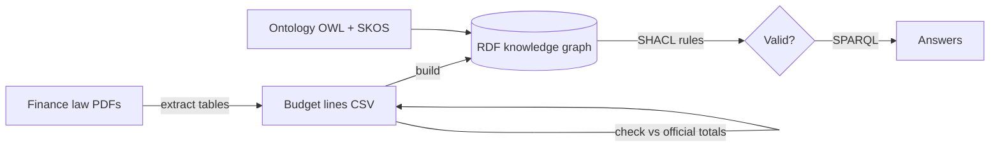

# Morocco Budget Knowledge Graph

A knowledge graph of Morocco's state budget (budget général), built from
five finance laws: **LF 2023, LF 2024, LF 2025, LF 2026 and PLF 2027**.

The budget tables are extracted from the official PDFs, checked against
the totals printed in each law, modeled with an **ontology** (OWL + SKOS),
stored as **RDF**, validated with **SHACL** rules, and queried with
**SPARQL**.

## Why a knowledge graph

Ministries change names with each government, but their **budget code**
stays the same (13 = Finance, 12 = Health...). The graph links every year
of an institution through that code, keeps each official name as it was
written in each law, and tells a real renaming apart from a spelling
variation (' vs ’, É vs E).

## Results

**State budget by category (billion MAD, payment credits)**

| Year | Operating | Investment | Debt service |
| ---- | --------- | ---------- | ------------ |
| 2023 | 271.1     | 106.0      | 109.2        |
| 2024 | 279.4     | 118.1      | 100.6        |
| 2025 | 321.0     | 128.5      | 107.3        |
| 2026 | 347.5     | 136.1      | 108.2        |
| 2027 | 387.1     | 138.0      | 115.3        |

**Findings**

- **Health and education now clearly exceed debt service:**
  114 vs 109 billion MAD in 2023, 167 vs 115 in 2027.
- **Largest investment increases 2023 → 2027:** housing and urban
  planning ×5 (0.9 → 4.8 billion MAD), industry ×3.6, health +81%
  (8.0 → 14.5).
- **13 institutions renamed** between 2024 and 2027, detected
  automatically. Example: budget code 33 went from _Ministère délégué
  chargé de la Transition Numérique_ to _Ministère de l'Intelligence
  Artificielle, de la Transformation Numérique et de la Réforme de
  l'Administration_.

## How it works



1. **Extraction:** reads Tableau B (operating), C (investment) and D
   (debt service) from each law: 562 budget lines.
2. **Validation:** the sum of the extracted lines must equal the official
   total printed in each table, otherwise the pipeline stops.
3. **Ontology:** classes _Institution_, _Ministry_, _FinanceLaw_
   (_VotedLaw_, _DraftLaw_), _Allocation_, _OfficialName_, and the budget
   nomenclature as a SKOS hierarchy (Operating → Staff, Equipment...).
4. **Graph:** about 5,000 RDF triples.
5. **SHACL:** every allocation has exactly one institution, one law and
   one budget line; amounts are never negative; every institution has a
   name.
6. **SPARQL:** questions answered on the graph (see `queries/`).

## Budget chapter codes

```
1.2 . 1 . 1 . 0 . 13 . 000
      |   |       |
      |   |       └── institution (13 = Finance)
      |   └────────── budget line (1 = staff, 2 = equipment...)
      └────────────── title (1 = operating, 2 = investment, 3 = debt)
```

## Project structure

```
├── data/raw/          Finance law PDFs (French editions)
├── data/processed/    Extracted budget lines (CSV)
├── ontology/          Budget ontology (Turtle)
├── shapes/            SHACL validation rules
├── queries/           SPARQL questions
├── budget_kg/         Python code (extraction, graph, validation)
└── output/            Knowledge graph and query results
```

## Run it

```bash
python3 -m venv .venv
source .venv/bin/activate
pip install -r requirements.txt

python -m budget_kg.extract
python -m budget_kg.build_graph
python -m budget_kg.validate_graph
python -m budget_kg.run_queries
```

## Sources

Finance laws published by the Ministry of Economy and Finance and in the
Bulletin Officiel (French editions):
[finances.gov.ma](https://www.finances.gov.ma/fr/vous-orientez/Pages/plf2026.aspx).
PLF 2027 is a draft law, not yet voted.
